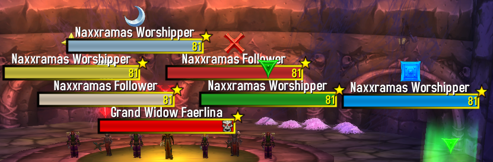

# StablePlates

> World of Warcraft **3.3.5a (WotLK)** addon · made by **feralpaw**

Calmer, tighter nameplate stacking that stays clickable. Your target's nameplate stays where it is; new overlapping plates are pushed to the side.

Works with **TidyPlates** and **ElvUI** nameplates.

## Commands
| Command | What it does |
|---|---|
| `/sp` or `/stableplates` | Help |
| `/sp on` · `/sp off` | Enable / disable |
| `/sp mode` | Switch stacking mode |
| `/sp gap <n>` · `/sp gapy <n>` | Horizontal / vertical spacing |
| `/sp smooth <0-5>` | Movement smoothing |
| `/sp friendly` | Toggle friendly plates |
| `/sp test` | Test mode |
| `/sp reset` | Reset settings |

## Installation
1. Download the latest ZIP from **Releases** (or *Code → Download ZIP*).
2. Copy `StablePlates` into `World of Warcraft/Interface/AddOns/`.
   The folder name must stay exactly like this (no `-main` suffix).
3. Restart the game or type `/reload`.

## License
MIT – see [LICENSE](LICENSE).
